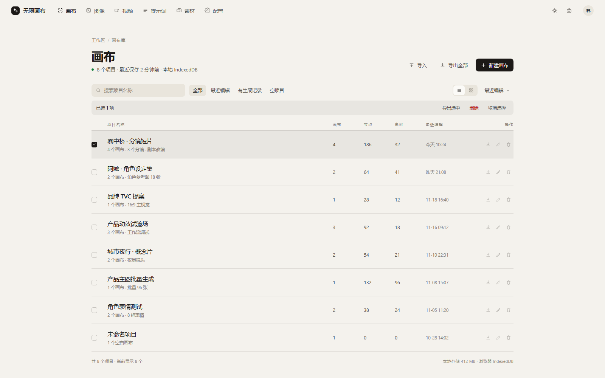
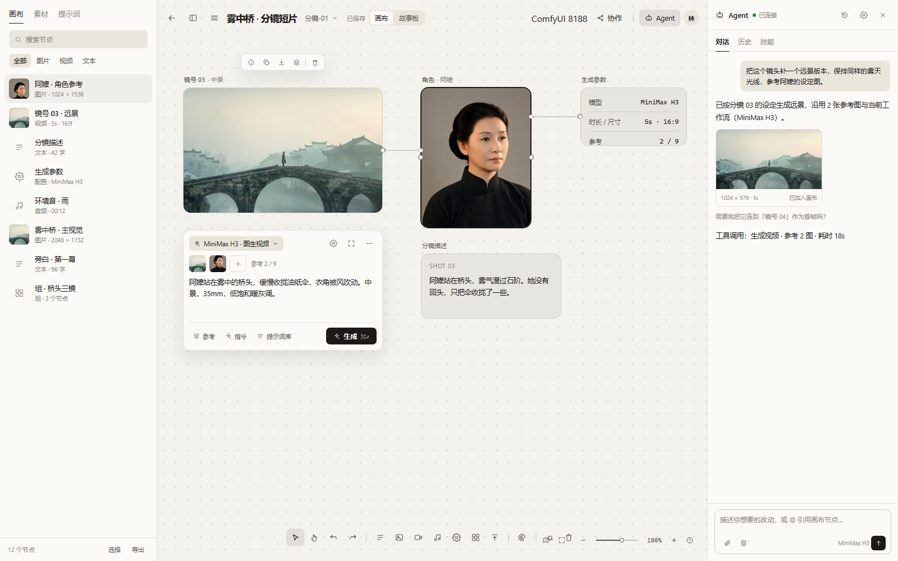
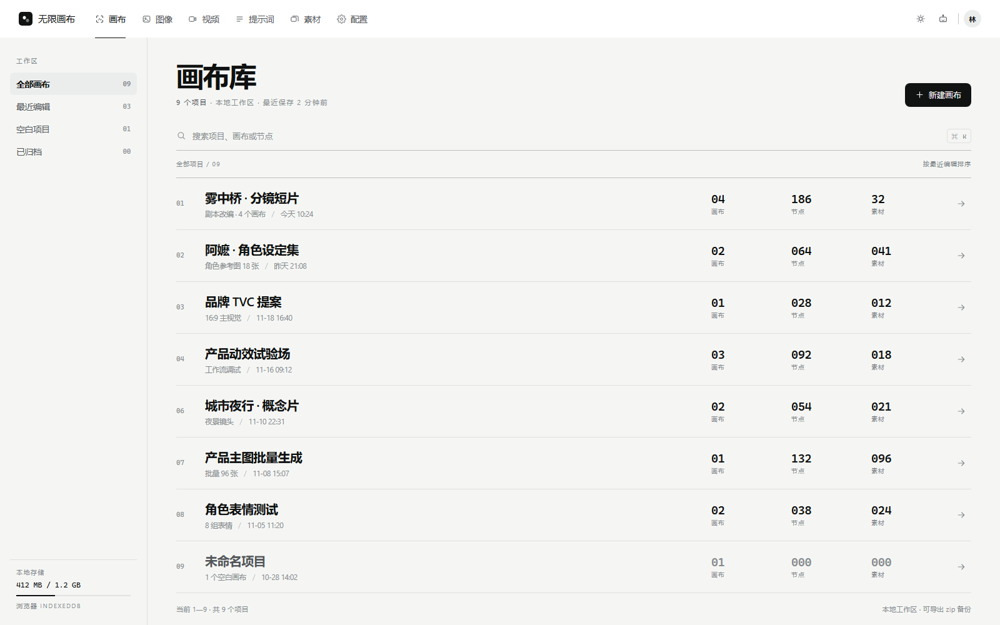
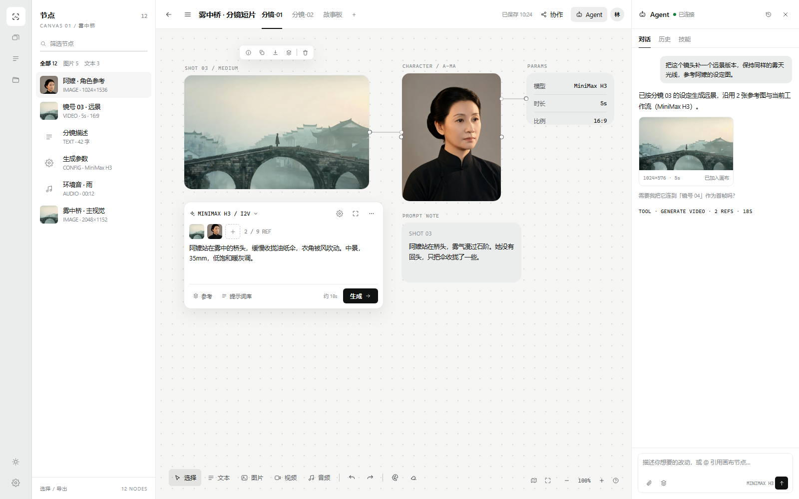
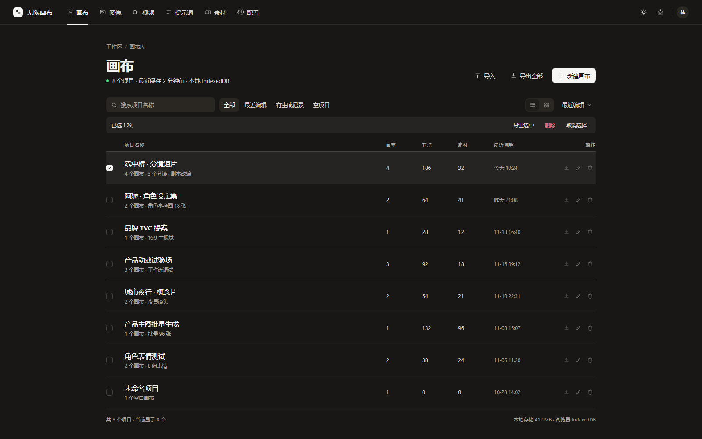
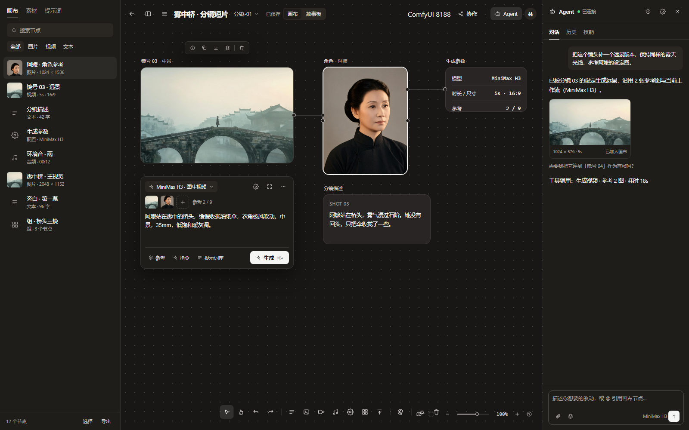

# 无限画布 Web 前端 UI 重设计方案（评审稿）

> 本轮只做只读盘点与设计方案，不改动任何项目代码。
> 稿件目录：`2026-11-21/ui-redesign/outputs/`；可直接查看的界面设计稿共 8 张（2 个方向 × 2 个界面 × 亮/暗）。

---

## 0. 结论摘要

1. **推荐方向 A「静默工具台」作为整体基线**，吸收方向 B 的三项做法：等宽数字、字号对比、项目索引栏。
2. 重设计的核心不是换颜色，而是**收敛现有 4 套并行的样式来源**（antd token、`canvasThemes`、shadcn CSS 变量、散落的 Tailwind 硬编码），建立一套画布内外通用的语义 token。
3. 项目库从「大色块卡片网格」改为**列表工作台 + 上下文操作条**；画布保留现有结构，但统一浮动容器的规格，并把底部工具条改为真正扁平的图标组。
4. 实施按 5 个阶段推进，Phase 0 只建 token 与基础组件（不产生视觉回归），后续每个阶段可独立验收、独立回滚。

### 稿件索引

| 方向 | 界面 | 亮色 | 暗色 |
| --- | --- | --- | --- |
| A 静默工具台 | 项目库 | `A-library-light.png` | `A-library-dark.png` |
| A 静默工具台 | 画布编辑 | `A-canvas-light.png` | `A-canvas-dark.png` |
| B 版面驱动 | 项目库 | `B-library-light.png` | `B-library-dark.png` |
| B 版面驱动 | 画布编辑 | `B-canvas-light.png` | `B-canvas-dark.png` |

设计稿均按 1600×1000 视口出图，内容基于项目真实信息结构（画布/节点/素材计数、更新时间、文档切换、视图切换、节点类型、工作流参数、Agent 对话与生成结果卡片）。

---

## 1. 范围与一个前提说明

覆盖界面：

- 项目库 / 画布列表（`web/src/pages/canvas/index.tsx`、`canvas-project-card.tsx`）
- 画布编辑页（`web/src/pages/canvas/project.tsx` + 顶栏、左侧面板、节点、节点提示词面板、底部工具条、缩放/小地图）
- Agent 面板（`web/src/components/agent/*`）
- 管理型页面：素材、提示词、配置、工作流、社区

**前提说明：当前代码中不存在 `pages/admin/` 管理后台**（全仓 grep `admin` 仅命中 i18n 文案、Agent 技能视图与一个测试）。`AGENTS.md` 中提到的 `admin/assets`、`admin/prompts` 属于历史结构。因此本方案把「管理后台」理解为**素材 / 提示词 / 配置 / 工作流 这四类管理型界面**，给出统一规范；真正新建后台时直接套用同一套 PageHeader 与表格 token，不另起一套视觉。

---

## 2. 现状盘点（只读）

### 2.1 技术栈与样式入口

| 项 | 现状 |
| --- | --- |
| 框架 | React 19 + Vite 7 + TypeScript |
| 组件库 | antd `^6.4.2` + `@ant-design/pro-components 3.0.0-beta.3` |
| 样式 | Tailwind CSS 4（`@tailwindcss/postcss`），`web/src/styles/globals.css` 单入口；引入 `tw-animate-css`、`shadcn/tailwind.css` |
| 图标 | `lucide-react` + 少量 antd 图标 |
| 主题 | Zustand `useThemeStore`（默认 `dark`）；antd `ConfigProvider` 全局一处（`app-providers.tsx`）；画布另有 `canvasThemes` |
| 字体 | `main.tsx` 直接给 `body.style.fontFamily` 赋值：`SF Pro Display / SF Pro Text / PingFang SC / Microsoft YaHei / Helvetica Neue` |
| i18n | react-i18next，`zh-CN.ts`、`en-US.ts` 各 2668 行，键值一一对应 |

### 2.2 页面骨架

- `UserLayout` = `AppTopNav`（56px、sticky、`max-w-7xl`、下划线式导航）+ 内容区 + 右侧常驻 `AgentPanel`（360–760px，可拖拽，`z-70`）。
- 顶部导航只有 6 项：画布 / 图像 / 视频 / 提示词 / 素材 / 配置（`constant/navigation-tools.ts`）；社区、指南、定价等页面存在但不进主导航。
- 画布项目页 `/canvas/:id` 隐藏 AppTopNav，使用独立的画布顶栏。

### 2.3 项目库

- 容器 `max-w-6xl`（1152px）、`px-6 py-10`；标题 30px；副信息 12px。
- 卡片：`rounded-2xl`、浅亮色块 `#f1eee8`（暗色 `bg-white/5`）、`p-5`、高度 176px，网格 1/2/3 列；无预览图。
- 操作按钮平铺 5 个：导出选中 / 删除选中 / 导出全部 / 删除全部 / 导入 / 新建，全部同级排在同一行；选中态才出现的按钮会挤动主按钮位置。

### 2.4 画布编辑页

- 左面板 280px（可拖 220–480），顶部 3 个文字 tab，列表项含缩略图与类型；底部有选择/导出。
- 顶栏 `absolute h-16` 透明悬浮；底部工具条 `h-14`、带 `rounded-xl border shadow-lg backdrop-blur`；缩放控件在左下，也是 `h-14` 的带边框容器；小地图 240×160。
- 节点 `rounded-2xl / 3xl`，提示词面板 `rounded-xl`，节点悬浮工具条独立浮层。
- 结论：三处浮动容器（顶栏、底栏、缩放条）视觉语言不一致——一个透明、两个带边框+阴影+模糊；按钮尺寸混用 26/28/32/40。

### 2.5 Agent 面板

- 右侧 dock，宽 360–760，`border-l`；内部为对话、历史、技能三类视图 + 固定 composer。形态本身合理，问题主要是与左侧面板的字号/间距/圆角不统一。

### 2.6 一致性问题（量化）

| 问题 | 数据 |
| --- | --- |
| 硬编码中性色 | `stone-*` 出现 **721 次、分布在 47 个文件** |
| 手写暗色分支 | `dark:` 出现 **700 次** |
| 直接写十六进制颜色 | **159 处** |
| `bg-white` / `bg-black` | **141 处** |
| 容器宽度 | `max-w-5xl / 6xl / 7xl` 三种混用（项目库 6xl、提示词 7xl、配置 6xl、素材 7xl+6xl+5xl） |
| 字号 | 10/11/12/13/14/15/16/17/18/20/24/30 至少 12 级，无固定阶梯 |
| 圆角 | 6/7/8/10/12/14/16/18/24/999 混用 |
| 按钮高度 | 26/27/28/30/32/34/40/56 混用 |

这不是「换个配色」能解决的问题，需要在 token 层收敛，否则每次改版都会重新长出一批硬编码。

---

## 3. 两个风格方向

### 方向 A「静默工具台」— 延续并系统化现有克制扁平调性




**设计意图**：把「不做装饰的编辑工具」做彻底。暖纸色中性底、单一墨色强调、1px 发丝线、零卡片阴影；层级完全由留白、字号与对齐承担。项目库改成一行一项目的列表工作台，按钮只保留「新建」一个主操作；画布底部工具条去掉边框/阴影/胶囊底，变成真正浮在画布上的一组图标。

**取舍**：视觉重量最低，长时间编辑最省眼睛；代价是第一眼不够“惊艳”，且列表化牺牲了卡片式项目的展示感。适合以「效率工具」定位、老用户为主的场景。

### 方向 B「版面驱动」— 更现代的强排版方向




**设计意图**：用排版本身建立识别度。项目库左侧固定 236px 工作区索引，右侧以 44px 标题 + 20px 项目名 + 等宽大数字（04 / 186 / 032）构成强节奏；画布改为 64px 常驻图标轨 + 248px 面板，顶栏用文档标签页替代下拉，底部工具条左对齐并带文字标签。

**取舍**：识别度和“产品感”最强，信息扫描速度快；代价是信息密度更高、对字号/对齐/间距的执行精度要求严格，图标轨会新增一层需要学习的导航。实现成本明显高于 A（左侧面板结构要改）。

### 对比

| 维度 | A 静默工具台 | B 版面驱动 |
| --- | --- | --- |
| 视觉重量 | 极低 | 中高（大字号、强对比） |
| 信息密度 | 中 | 高 |
| 第一眼识别度 | 低 | 高 |
| 与现有代码的改动面 | 小（布局微调 + token） | 中大（左面板重构、顶栏改标签页） |
| 画布「极简扁平」规则符合度 | 高 | 中（图标轨增加常驻 chrome） |
| 长时编辑舒适度 | 高 | 中（对比更强、密度更高） |
| 暗色一致性风险 | 低（单色系） | 中（大字号对明度差更敏感） |

### 推荐

**以 A 为整体基线**，只吸收 B 的三项局部做法：

1. 数字与元数据用等宽 `tabular-nums`（计数、比例、时长、时间）；
2. 标题层级拉开（32 / 20 / 16 / 14 / 12 / 10.5），不再出现 10px 正文；
3. 项目库增加左侧索引栏的**信息组织方式**（全部 / 最近 / 空白），但不做常驻 236px 侧栏，改为列表上方的轻量筛选条。

理由：画布是产品核心，项目规范明确要求画布工具条极简扁平、低视觉重量；B 的常驻图标轨会让画布长期多一层 chrome，且需要改左侧面板的交互模型，收益不匹配成本。A 的结构足以承载「全部重新设计」，同时能把改动控制在可评审、可回滚的范围内。

---

## 4. 设计 Token（方向 A 基线）

### 4.1 色彩

语义 token 与现有 `canvasThemes` 的对应关系（新增 key 不破坏现有结构）：

| 语义 token | 用途 | 亮色 | 暗色 | 现有来源 |
| --- | --- | --- | --- | --- |
| `canvas.background` | 画布底 | `#f4f2ed` | `#181715` | 已有 |
| `surface` | 面板/弹层/卡片 | `#fbfaf7` | `#1f1d1a` | `toolbar.panel` / `node.panel` |
| `surface.sunken` | 输入框、悬浮组 | `#e9e5dc` | `#2a2723` | 新增 |
| `surface.hover` | hover 态 | `rgba(28,25,23,.05)` | `rgba(255,255,255,.06)` | 新增（替代 `hover:bg-black/5`） |
| `surface.active` | 选中态 | `rgba(28,25,23,.09)` | `rgba(255,255,255,.11)` | `toolbar.activeBg` |
| `hairline` | 分隔线/边框 | `rgba(68,64,60,.14)` | `rgba(245,245,244,.10)` | `node.stroke`/`toolbar.border` |
| `hairline.strong` | 表头线、强调边框 | `rgba(68,64,60,.26)` | `rgba(245,245,244,.20)` | 新增 |
| `text.primary` | 主文本 | `#1c1917` | `#f5f5f4` | `node.text` |
| `text.secondary` | 次文本 | `#57534e` | `#d6d3d1` | `node.label` |
| `text.tertiary` | 元数据、占位 | `#8a8479` | `#a8a29e` | `node.placeholder` |
| `text.inverse` | 反色按钮文字 | `#fafaf9` | `#181715` | 新增 |
| `action.primary` | 主按钮底 | `#1c1917` | `#f5f5f4` | 现有 antd `colorPrimary` |
| `node.fill` | 节点底色 | `#e7e5df` | `#292524` | 已有 |
| `state.success` | 连接/成功 | `#15803d` | `#4ade80` | 新增 |
| `state.warning` | 进行中 | `#b45309` | `#fbbf24` | 新增 |
| `state.danger` | 删除/失败 | `#b91c1c` | `#f87171` | 新增 |
| `focus.ring` | 键盘焦点 | `#1c1917` 30% | `#f5f5f4` 40% | 新增 |

规则：

- 画布内所有颜色必须来自 `canvasThemes`，不允许在组件里写 `stone-*` 或 hex；
- 画布外页面统一走 CSS 变量（`--surface`、`--text-primary`…）与 antd token，不再出现 `dark:` 分支；
- 语义色（成功/警告/危险）只用于状态，不用于装饰；
- B 方向的冷灰变体作为可选主题预留，不作为默认。

### 4.2 字体体系

**字族**

```css
--font-sans: ui-sans-serif, -apple-system, "Segoe UI", "PingFang SC",
             "Microsoft YaHei UI", "Microsoft YaHei", system-ui, sans-serif;
--font-mono: ui-monospace, "Cascadia Mono", "SF Mono", Consolas, monospace;
```

- 现有 `globals.css` 里 `--font-sans: var(--font-sans)` 是自引用，等于未定义；需修正。
- 不引入 Web Font（避免首屏阻塞与中文字体体积），用系统字体栈；macOS 走 PingFang，Windows 走雅黑。
- 等宽仅用于数字、比例、时间、ID、快捷键，不用于正文。

**字号阶梯（7 级）**

| 级别 | 字号/行高 | 字重 | 字距 | 用途 |
| --- | --- | --- | --- | --- |
| Display | 32 / 38 | 600 | -0.026em | 项目库标题、空状态标题 |
| Title | 20 / 28 | 600 | -0.02em | 分区标题、B 方向项目名 |
| Heading | 16 / 24 | 600 | -0.01em | 画布标题、面板标题、卡片标题 |
| Body | 14 / 22 | 400 | 0 | 默认正文、表单、列表 |
| Label | 13 / 19 | 500 | 0 | 按钮、tab、列表主字段 |
| Meta | 12 / 17 | 400 | 0 | 说明、时间、计数（tabular） |
| Micro | 10.5 / 14 | 500 | 0.14em 大写 | 表头、分组标签（仅英文/数字） |

中文正文最小 12px；不再使用 10px 作为正文。字重只用 400 / 500 / 600。

### 4.3 间距、圆角、阴影、动效

- 间距：4pt 网格，常用 `4 / 8 / 12 / 16 / 24 / 32 / 48`；页面左右 padding 32；面板内 padding 16；列表行高 52（面板）/ 73（项目库）。
- 圆角：控件 8、卡片/面板/节点 12–14、弹层 14；`999` 仅用于头像与状态点。
- 阴影：默认无阴影。只保留两级——浮层 `0 12px 32px rgba(28,25,23,.10)`（暗色 `.42` 黑）、模态 `0 18px 54px`。
- 动效：hover 120ms、面板展开 240–320ms，缓动统一 `cubic-bezier(.22,1,.36,1)`；遵循 `prefers-reduced-motion`。

### 4.4 控件尺寸

| 控件 | 尺寸 |
| --- | --- |
| 图标按钮 | 32×32（紧凑 26×26，仅用于节点悬浮工具条） |
| 主/次按钮 | 高度 32（紧凑 28、主页面 36） |
| 输入框 | 高 34（大号 38） |
| 画布工具按钮 | 32×32，组内 gap 2，组间分隔线 1×16 |
| 触控最小点击区 | 40×40（移动端） |

---

## 5. 与现有主题体系的对接方式

### 5.1 `canvasThemes` 扩展（不破坏现有调用）

在 `web/src/lib/canvas-theme.ts` 的每套主题中新增语义 key，保留原有 `node.*` / `toolbar.*`：

```ts
canvas: { background, dot, line, selectionStroke, selectionFill }
surface: { base, sunken, hover, active }
hairline: { base, strong }
text: { primary, secondary, tertiary, inverse }
state: { success, warning, danger }
```

迁移期用别名映射旧 key（`toolbar.panel → surface.base`），组件逐步改用新语义 key，最后删除别名。

### 5.2 antd `ConfigProvider`

在 `web/src/lib/app-theme.ts` 补充尺寸与字体 token（当前只有颜色）：

```ts
token: {
  borderRadius: 8, borderRadiusLG: 12, borderRadiusSM: 6,
  controlHeight: 34, controlHeightSM: 28, controlHeightLG: 38,
  fontFamily: "var(--font-sans)",
  fontSize: 14, fontSizeSM: 12, fontSizeLG: 16,
  colorBgLayout: "#f4f2ed",
  colorBorder: "rgba(68,64,60,.14)",
  colorBorderSecondary: "rgba(68,64,60,.10)",
  motionDurationMid: "0.18s",
}
```

- 只保留全局一处 ConfigProvider；页面内不再局部覆盖颜色。
- Dropdown / Menu / Select 的弹层颜色继续由全局组件 token 控制（已有做法），不新增局部覆盖。

### 5.3 全局 CSS

- 修复 `--font-sans` 自引用，建立字号/动效变量。
- 把 `.prompt-filter-tag` 这类页面私有样式迁回页面作用域（`prompts/index.tsx` 所在目录）。
- `globals.css` 只保留：变量、reset、滚动条、跨页面通用工具类、第三方组件必要覆盖。

### 5.4 硬编码收敛策略

1. 先在 Tailwind `@theme` 中注册语义颜色（`--color-surface`、`--color-hairline`…），得到 `bg-surface`、`text-secondary`、`border-hairline` 等类；
2. 按目录分批替换 `stone-*` / `bg-white` / `bg-black` / hex（脚本 + 人工复核），每批一个可运行的 commit；
3. 画布目录 `components/canvas/**` 优先改为 `canvasThemes` 读取，禁止新增 `dark:`；
4. 替换完成后加一条 lint/CI 检查：`components/canvas` 内禁止出现 `stone-` 与 hex 颜色。

---

## 6. 布局规范

### 6.1 App Shell

- 顶栏高度 56px，内容容器统一 `max-w-[1180px]`（项目库、配置、素材、提示词一致）；社区/定价等展示页可用更宽容器，但需显式声明。
- 顺序：Logo + 产品名 → 主导航（6 项）→ 右侧（主题、Agent、账户）。
- 导航激活态用 1px 下划线，不做胶囊底。
- 所有页面共用 PageHeader 规格：eyebrow 12px / 标题 32px / 副信息 13px / 主操作右上角，距内容 24–32px。

### 6.2 项目库（方向 A 推荐）



- 结构：PageHeader → 筛选工具栏（搜索、状态筛选、视图切换、排序）→ 选中上下文条 → 列表 → 页脚统计。
- 列表列：勾选 / 项目名（含一行摘要）/ 画布 / 节点 / 素材 / 最近编辑 / 行内操作。
- 行内操作默认低透明度，hover 时显现；破坏性操作用危险色。
- 空状态：保留 360px 高，标题 20px + 说明 14px + 单个主按钮。
- 网格视图保留为切换项，卡片规格：`rounded-xl`、无阴影、`surface` 底、标题 16/600、信息 12。

### 6.3 画布编辑页



- **顶栏**：左（返回 / 面板开关 / 菜单 / 标题 / 文档切换），中（画布-故事板切换），右（连接状态 / 协作 / Agent / 账户）。透明悬浮、无边框、按钮 32×32。
- **左侧面板**：280px，三 tab（画布 / 素材 / 提示词），下方搜索、类型筛选、列表、底部统计与选择/导出。
- **节点**：标签在节点上方 11px；圆角 14；选中态用 1px 强调描边 + 1px 外扩，不用阴影；悬浮工具栏居中于节点上方 30px，按钮 26×26。
- **节点提示词面板**：贴在节点下方 12–16px；圆角 12、1px 边框、浮层阴影；**工具条在上、输入在下**；参考资源行在输入上方；生成按钮固定右下；最大高度 `60vh`，正文独立滚动，模型/参数/提交区始终可见。
- **底部工具条**：真正扁平——无容器、无边框、无阴影、无胶囊底；分组为「选择与历史 | 创建 | 外观 | 破坏性」，组间 1px 分隔线；默认图标色 `text.secondary`，hover 浅底，选中态才用 `surface.active`。
- **缩放/小地图**：缩放移至右下（与 Agent 面板留 18px），小地图按钮并入缩放组；小地图浮层 240×160，圆角 12。

### 6.4 Agent 面板

- 右侧 dock 340px（可拖 320–520），`border-l` + `surface` 底。
- Header 54px：图标 + 标题 + 连接状态点 + 历史/设置/关闭。
- 对话消息：用户消息右对齐 `surface.sunken` 圆角 10；助手消息不留气泡，14/24 正文；工具调用用 10.5px 等宽小字。
- Composer 固定在底部，圆角 10、1px 边框，输入区 3 行，发送按钮 26×26 反色。

### 6.5 管理型页面

统一：PageHeader → 筛选区（左筛选、右搜索/新建）→ 表格或卡片列表 → 分页/统计。表格行高 56，表头 `surface.sunken`，选中行用 `surface.active`，操作列固定在右侧。抽屉宽度 480，模态 520。

---

## 7. 按钮位置与分组规范

### 7.1 层级

| 层级 | 形态 | 使用规则 |
| --- | --- | --- |
| Primary | 反色实心 | 每个视图最多 1 个，固定在右上角（如「新建画布」「生成」「保存」） |
| Secondary | 文字/幽灵按钮 | 放在 Primary 左侧，最多 2 个（如「导入」「导出」） |
| Tertiary | 32×32 图标按钮 | 工具栏、行内、面板头部 |
| Danger | 危险色文字或图标 | 行内/菜单内，必须二次确认；不与 Primary 相邻 |
| Contextual | 上下文操作条 | 选中后才出现，位于列表上方，不挤动页面级按钮 |

### 7.2 位置矩阵

| 场景 | 左侧 | 右侧 | 说明 |
| --- | --- | --- | --- |
| 页面头部 | 标题/说明 | Primary + Secondary | 破坏性操作收进「更多」 |
| 列表工具栏 | 搜索、筛选 | 视图切换、排序 | 不与页面级按钮混排 |
| 列表行 | — | 导出/重命名/删除 | 默认 50% 透明度，hover 显现 |
| 画布顶栏 | 返回、面板、菜单、标题、文档 | 连接、协作、Agent、账户 | 视图切换居中偏左 |
| 画布底栏 | 选择/历史 → 创建 → 外观 | 破坏性（清空） | 组间分隔线，不用容器 |
| 节点悬浮条 | 信息/复制/下载/存素材 | 删除 | 居中于节点上方 |
| 提示词面板 | 模型/工作流 | 设置/展开/更多 | 生成按钮固定右下 |
| 弹层 | 取消 | 确认（主操作） | 危险确认用危险色，文案说明后果 |

### 7.3 明确禁止

- 5 个以上同级按钮平铺在一行；
- 用灰色 `activeBg` 当普通按钮底色；
- 给工具按钮加胶囊背景、边框、阴影；
- 页面内局部覆盖 antd 弹层颜色；
- 在组件里写 `dark ? ... : ...` 主题分支。

---

## 8. 分阶段实施顺序

### Phase 0 — Token 与基础件（无视觉回归）

- 修正 `--font-sans`，建立字号/间距/圆角/动效变量；
- 扩展 `canvasThemes` 语义 key 与 `app-theme.ts` 尺寸 token；
- 在 Tailwind `@theme` 注册语义颜色；
- 产出 `Button` / `IconButton` / `Panel` / `Hairline` 四个基础件（仅内部使用，先替换 2–3 个页面验证）。
- 验收：页面外观不变，token 可读，TypeScript/构建通过。

### Phase 1 — App Shell + 项目库

- 统一顶栏容器宽度与 PageHeader；
- 项目库改列表 + 上下文操作条 + 空状态；
- 清理该页 `stone-*` 与 hex。
- 验收：亮/暗两套截图，键盘可达，选中/批量/删除流程不变。

### Phase 2 — 画布 chrome

- 顶栏按钮分组与尺寸统一；
- 左侧面板 tab/搜索/筛选/列表规格；
- 底部工具条改扁平分组；
- 缩放与小地图合并到右下。
- 验收：不改变任何画布交互与快捷键；60fps 拖拽不受影响。

### Phase 3 — 节点与提示词面板

- 节点圆角/描边/选中态统一；
- 悬浮工具条尺寸与位置；
- 提示词面板布局：工具条在上、输入在下、正文滚动、提交区常驻；
- 配置/视频/音频/图片设置弹层统一为 18px 内边距、圆角 14。
- 验收：挂载真实面板，确认生成按钮完整可见、可点击，窄高度下不重叠。

### Phase 4 — Agent 与维护型页面

- Agent 面板字号/间距/消息样式；
- 素材、提示词、配置、工作流页面套用 PageHeader 与表格规格；
- 如后续新建管理后台，直接复用本节规范。

### Phase 5 — 暗色、响应式、无障碍与清理

- 全站暗色回归（组件级亮暗对比截图）；
- 焦点态、键盘操作、对比度（正文 ≥ 4.5:1）；
- 移动端顶栏/抽屉/画布最小可用；
- 清理剩余硬编码并加 CI 检查；
- 更新 `CHANGELOG.md`、`pending-test.mdx`。

---

## 9. 验收清单与风险

### 验收清单

- [ ] 亮/暗两套主题下，同一组件不出现颜色反转错误或对比度不足；
- [ ] 项目库 8 项以上时仍不出现整页滚动条（内容区内滚动）；
- [ ] 画布顶栏/底栏/缩放三处视觉语言一致；
- [ ] 提示词面板在 600px 高度下生成按钮可见可点；
- [ ] 所有新文案进入 `zh-CN.ts` / `en-US.ts`，无硬编码中文；
- [ ] `components/canvas/**` 无 `stone-*`、无 hex、无 `dark:` 分支；
- [ ] 键盘可完成：打开项目、切换面板、选中节点、填写提示词、生成；
- [ ] 暗色下正文对比度 ≥ 4.5:1，元数据 ≥ 3:1。

### 风险

| 风险 | 说明 | 缓解 |
| --- | --- | --- |
| 改动面大 | 47 个文件含 stone 硬编码 | 分阶段、按目录替换、每阶段独立验收 |
| 画布性能 | 顶栏/面板重渲染可能影响拖拽 | 只改样式与结构，不动 `project.tsx` 的状态与 ref 逻辑 |
| antd 6 行为 | 尺寸 token 可能与现有组件默认冲突 | Phase 0 先小范围验证 Button/Select/Table |
| i18n 遗漏 | 新增文案需双语言 | 每个阶段结束跑 key 对齐检查 |
| 主题回归 | 暗色下大字号对比过强 | 用组件级截图对比，限制字重 ≤ 600 |
| 方向选择 | B 的结构改动更大 | 若选 B，需单独评估左面板图标轨的交互成本 |

---

## 10. 稿件复现

设计稿为静态 HTML + headless Edge 截图，源文件在 `2026-11-21/ui-redesign/mockup-src/`：

- `mock.css`：两套方向与亮暗主题的 token 与组件样式
- `A-library.html` / `A-canvas.html` / `B-library.html` / `B-canvas.html`
- `assets/film-still.jpg`、`assets/portrait-ref.jpg`：节点内容占位图

复现命令（Windows）：

```powershell
& "C:\Program Files (x86)\Microsoft\Edge\Application\msedge.exe" `
  --headless=new --disable-gpu --hide-scrollbars --window-size=1600,1000 `
  --screenshot="outputs\A-library-light.png" `
  "file:///D:/infinite-canvas/2026-11-21/ui-redesign/mockup-src/A-library.html"
```

暗色版在 URL 后加 `?dark`。

---

**待确认**：方向选择（A / B / A+B 局部）、是否接受项目库列表化、Phase 0 是否立即开始。
